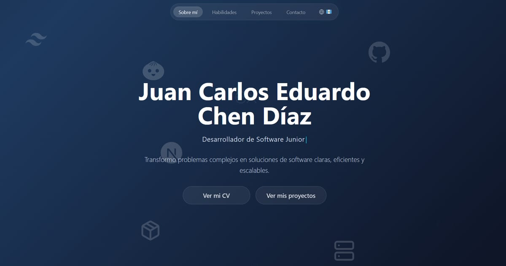

<div align="center">

# Portafolio Web

Portafolio personal bilingüe (español / inglés) que presenta mi perfil, mis habilidades y los proyectos en los que he trabajado.

**[Ver sitio en vivo → jc-portfolio.cc](https://www.jc-portfolio.cc)**

[](https://react.dev)
[](https://www.typescriptlang.org)
[](https://vite.dev)
[](https://tailwindcss.com)
[](https://daisyui.com)
[](https://vitest.dev)
[](https://pnpm.io)
[](https://vercel.com)



</div>

---

## Características

- **Bilingüe:** todo el contenido está disponible en español e inglés; el idioma elegido se recuerda entre visitas.
- **Proyectos detallados:** cada proyecto tiene su propia página (`/proyecto/:id`) con el problema, la solución, las tecnologías utilizadas, sus características y una galería de capturas con vista ampliada.
- **Habilidades por categoría:** lenguajes, frameworks, bases de datos, infraestructura y herramientas, cada una con su logotipo.
- **Visor del CV** integrado en `/cv`.
- **Diseño animado y responsivo:** fondos con degradados animados, iconos flotantes, texto con efecto de escritura y aparición de secciones al hacer scroll, adaptado a móvil, tableta y escritorio.
- **Accesible:** navegación por teclado, etiquetas para lectores de pantalla y respeto a la preferencia del sistema de reducir el movimiento.
- **Página 404** para rutas inexistentes.
- **Optimizado:** imágenes en WebP con varios tamaños, carga diferida de páginas e imágenes, y animaciones que se pausan fuera de pantalla.

## Rendimiento

Resultados de [Lighthouse](https://developer.chrome.com/docs/lighthouse) sobre el sitio en producción:

| Categoría | Móvil | Escritorio |
|---|:---:|:---:|
| Rendimiento | 97 | 100 |
| Accesibilidad | 100 | 100 |
| Buenas prácticas | 100 | 100 |
| SEO | 100 | 100 |

La página principal pesa unos **240 KB** en total y su contenido principal se muestra en menos de 1,5 s en móvil.

## Tecnologías

| Área | Tecnología |
|---|---|
| Interfaz | React 19, TypeScript 7 |
| Estilos | Tailwind CSS 4, DaisyUI 5 |
| Enrutado | React Router 7 |
| Idiomas | i18next + react-i18next |
| Iconos | Lucide React, Simple Icons |
| Build | Vite 8 |
| Pruebas | Vitest 5 |
| Imágenes | sharp (generación de WebP) |
| Gestor de paquetes | pnpm 12 |
| Despliegue | Vercel + Vercel Analytics |

## Inicio rápido

### Requisitos

- **Node.js 22.12** o superior
- **pnpm 12** — el proyecto fija la versión exacta en `package.json`. La forma recomendada de obtenerla es [Corepack](https://github.com/nodejs/corepack), incluido con Node.js hasta la versión 24:
  ```bash
  corepack enable
  ```

> Usa únicamente **pnpm**. Instalar con npm o yarn ignora el lockfile y puede instalar versiones distintas.

### Instalación

```bash
git clone https://github.com/Juan-D15/portafolio-web.git
cd portafolio-web/portafolio-jcd
pnpm install
pnpm dev
```

El sitio queda disponible en [http://localhost:5173](http://localhost:5173).

> La aplicación vive en la carpeta `portafolio-jcd/`: todos los comandos se ejecutan desde ahí.

## Comandos

| Comando | Descripción |
|---|---|
| `pnpm dev` | Servidor de desarrollo con recarga instantánea |
| `pnpm build` | Build de producción en `dist/` |
| `pnpm preview` | Sirve localmente el build de producción |
| `pnpm type-check` | Verifica los tipos de TypeScript |
| `pnpm test` | Ejecuta las pruebas una vez |
| `pnpm test:watch` | Ejecuta las pruebas y las repite al guardar cambios |
| `pnpm images` | Genera las imágenes WebP a partir de los originales |

Antes de subir cambios conviene ejecutar `pnpm type-check`, `pnpm test` y `pnpm build`.

## Estructura

```
portafolio-web/
├── package.json             # Solo fija la versión de pnpm para Vercel (ver Despliegue)
└── portafolio-jcd/          # Aplicación
    ├── image-sources/       # Capturas originales PNG/JPG (no se publican)
    ├── public/
    │   ├── images/          # Imágenes WebP generadas por `pnpm images`
    │   └── cv/              # CV en PDF
    ├── scripts/             # optimize-images.mjs
    ├── src/
    │   ├── components/      # Secciones de la página: Navbar, Hero, About, Skills, Projects, Contact
    │   ├── pages/           # ProjectDetail, CvPage, NotFound
    │   ├── hooks/           # Lógica de interfaz (carrusel, animaciones, scroll...)
    │   ├── data/            # projectsData.ts, skillsData.ts
    │   ├── locales/         # Textos en es.json y en.json
    │   └── utils/           # Iconos e imágenes
    ├── tests/               # Pruebas de Vitest
    └── vercel.json          # Caché, redirecciones y enrutado de la SPA
```

## Añadir un proyecto

1. Copia las capturas originales (PNG o JPG) en `image-sources/<carpeta-del-proyecto>/` y ejecuta:
   ```bash
   pnpm images
   ```
   Se generan cuatro tamaños WebP de cada imagen en `public/images/`. No coloques imágenes directamente en `public/images/`.
2. Añade el proyecto en `src/data/projectsData.ts`:
   - `id`: identificador único; forma la URL `/proyecto/<id>`.
   - `images`: rutas **sin tamaño ni extensión**, por ejemplo `"/images/amg/inicio2-amg"`. La primera es la portada de la tarjeta.
   - `technologies`, `liveUrl` y `githubUrl` (deja `""` para ocultar el botón).
3. Escribe los textos en **`src/locales/es.json` y `src/locales/en.json`**, dentro de `projects.data.<id>`: `title`, `shortDescription`, `fullDescription` y `features`.
   > La página muestra los textos **solo desde estos archivos**, no desde `projectsData.ts`.
4. Si una tecnología no tiene icono, añádela en `src/utils/techIconMapper.ts` y `src/utils/iconRenderer.tsx`.
5. Ejecuta `pnpm test`: las pruebas avisan si falta algún texto, imagen o icono.

## Despliegue

El sitio se despliega automáticamente en **Vercel** con cada push a `main`. Configuración del proyecto en Vercel:

| Ajuste | Valor |
|---|---|
| Root Directory | `portafolio-jcd` |
| Variable de entorno | `ENABLE_EXPERIMENTAL_COREPACK=1` |

Con esa variable, Vercel usa la misma versión de pnpm que en local. Vercel la lee del `package.json` de la **raíz del repositorio**, por eso existe ese archivo: su `packageManager` debe coincidir siempre con el de `portafolio-jcd/package.json`.

## Autor

**Juan Carlos Eduardo Chen Díaz** — Desarrollador de Software Junior

[](https://www.linkedin.com/in/juan-chendiaz/)
[](https://github.com/Juan-D15)
[](mailto:jdiaz45c@gmail.com)
